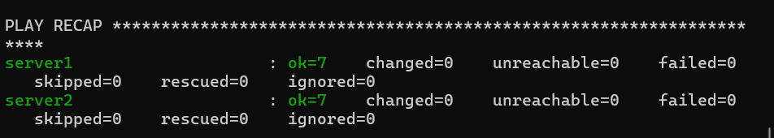

# Laboratorio Docker y Ansible

## Objetivo
Crear dos servidores Linux Ubuntu utilizando Docker y
administrarlos automáticamente mediante Ansible.

## Iniciar los servidores
```bash
docker compose up -d
docker ps
```

## Ejecutar el playbook
```bash
ansible-playbook -i inventory.ini playbook.yml
```

## Funcionalidades
- Mostrar el nombre de cada servidor.
- Identificar el sistema operativo.
- Crear la carpeta /tmp/ansible-demo.
- Crear el archivo info.txt.
- Crear directorios utilizando un loop.
- Mostrar un mensaje condicional para Ubuntu.

## Evidencia

